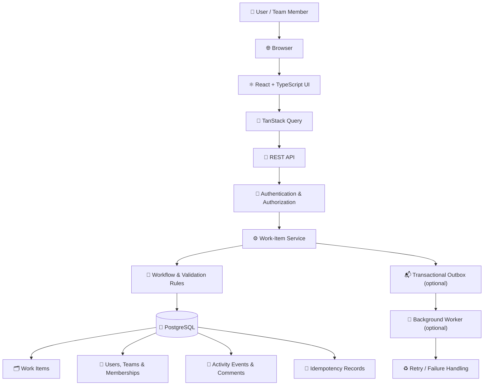
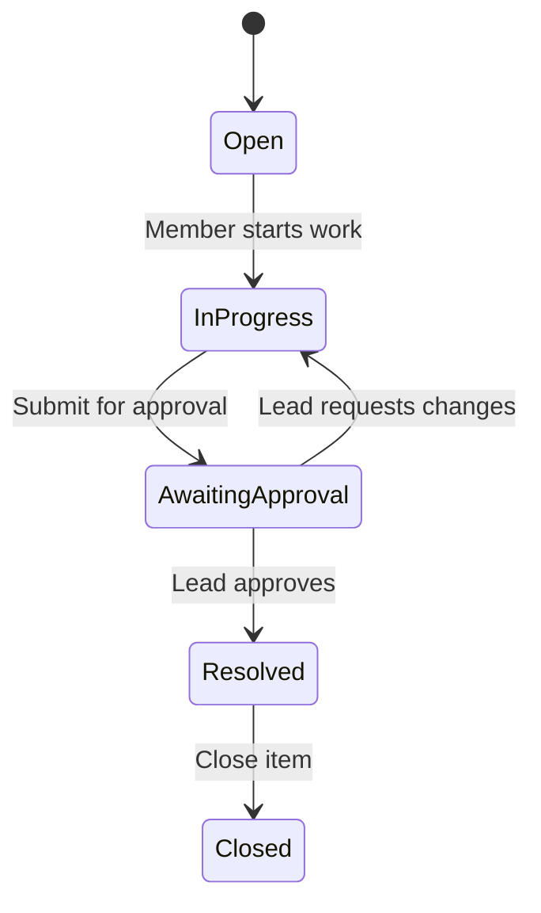

<div align="center">

# NEWTOO

### ⚙️ Operations Under Pressure — Full-Stack Work Management Platform

**Create. Assign. Track. Resolve.**  
A team-focused web application concept for managing operational work items, workflows, and accountability.

[🌐 Live Demo](https://newtoo.kartikcomtech.in/public/login) · [💻 GitHub Repository](https://github.com/shivammishhra5/newtoo)


</div>

---

## 📌 Table of Contents

- [✨ Overview](#-overview)
- [🎯 Core Features](#-core-features)
- [🧰 Technology Stack](#-technology-stack)
- [🏗️ System Architecture](#️-system-architecture)
- [🔄 Work-Item Lifecycle](#-work-item-lifecycle)
- [🛡️ Security and Reliability](#️-security-and-reliability)
- [⚡ Getting Started](#-getting-started)
- [🧪 Testing Strategy](#-testing-strategy)
- [🧠 Engineering Decisions](#-engineering-decisions)
- [⚠️ Known Limitations](#️-known-limitations)
- [🤝 Contributing](#-contributing)
- [📄 License](#-license)

## ✨ Overview

**newtoo** is a team-oriented work management platform concept designed to bring operational tasks into one central workspace. It focuses on assigning ownership, managing priorities, progressing work through defined states, and preserving an understandable activity history.

The engineering goal is not simply to provide CRUD screens. It is to handle important real-world cases such as conflicting updates, duplicate requests, team-level permissions, and traceable changes.

> 💡 **Project principle:** Prefer reliable behaviour, clear engineering decisions, and tested workflows over unnecessary feature count.

## 🎯 Core Features

> The list below describes the intended project scope. Keep each item only if it is implemented in the current repository.

- 🗂️ **Work-item management** — create, view, update, assign, and resolve operational items.
- 🔁 **Controlled workflow** — manage states such as Open, In Progress, Awaiting Approval, Resolved, and Closed.
- 👥 **Team-based roles** — support role concepts such as Viewer, Member, Lead, and Admin.
- 📊 **Action-oriented dashboard** — highlight assigned work, urgent unassigned items, and pending approvals.
- 🔎 **Search, filters, and pagination** — find relevant items without loading the entire dataset into the browser.
- 🧾 **Activity timeline** — record important changes to state, owner, and priority, along with comments.
- 🔐 **Server-side authorization** — validate permissions for protected operations and team-owned resources.
- ⚔️ **Concurrency safeguards** — handle competing claims and stale edits safely.
- 🔁 **Idempotent requests** — prevent retries or double submissions from creating duplicate records.
- 🧪 **Automated tests** — verify critical workflow, authorization, and conflict behaviour.

## 🧰 Technology Stack

The following is the **recommended stack** for this architecture. Verify the actual dependencies in the repository before presenting every technology as implemented.

| Layer | Technology | Purpose |
|---|---|---|
| 🎨 Frontend | React.js + TypeScript | User interface and typed components |
| 🔄 Data fetching | TanStack Query | Caching, refetching, and server-state management |
| ⚙️ Backend | PHP + Node.js + Express.js + TypeScript | API endpoints and application logic |
| 🔌 API | REST | Communication between frontend and backend |
| 🐘 Database | PostgreSQL | Persistent relational data and transactions |
| 🧬 ORM | Prisma | Database access and migrations |
| 🧪 Testing | Jest + Supertest | Automated API and behaviour tests |
| 🐳 Local environment | Docker Compose | Repeatable local services |
| 📬 Background jobs (optional) | PostgreSQL outbox or BullMQ + Redis | Reliable asynchronous processing |
| 🌿 Version control | Git + GitHub | Source control and collaboration |

## 🏗️ System Architecture

The diagram below illustrates the **proposed architecture**. Adjust it to match the implementation in this repository.



### 🔍 Request lifecycle

1. 👤 A user performs an action in the browser.
2. ⚛️ The frontend sends a request through the API client.
3. 🔐 The backend authenticates the user and checks access to the relevant team and resource.
4. ⚙️ The service validates the requested change and allowed workflow transition.
5. 🐘 The database applies the change transactionally, including its activity event where supported.
6. ✅ The API returns a success or a clear error response.
7. 🔄 The frontend refreshes or reconciles the displayed data.

## 🔄 Work-Item Lifecycle

The following is an example workflow for the proposed system. Enforce transitions on the server, not only in the UI.



### 🧭 Example dashboard views

- 📌 **Assigned to me** — items owned by the current user.
- 🚨 **Unassigned urgent** — high-priority items without an owner.
- 🕒 **Awaiting my approval** — items requiring action from an authorized Lead.
- 🔍 **Filtered work list** — search and filter by status, priority, team, or assignee.

## 🛡️ Security and Reliability

- 🔐 **Authorization:** enforce permissions on the server for every protected action.
- ⚔️ **Concurrency:** use conditional updates or version checks to prevent conflicting edits.
- 🔁 **Idempotency:** make retried requests safe when supported by the API.
- 🧾 **Consistent history:** write activity events in the same transaction as the corresponding change.
- 📄 **Pagination:** filter and paginate large datasets on the server.
- 🔑 **Secrets management:** keep passwords, tokens, and production credentials out of Git.
- 🔒 **Transport security:** use HTTPS in production.
- 💾 **Backups:** back up production data before schema changes or deployments.

## ⚡ Getting Started

### 📋 Prerequisites

Install the versions compatible with the repository configuration:

- 🟢 Node.js and npm
- 🐘 PostgreSQL, or Docker with Docker Compose
- 🌿 Git

### 1️⃣ Clone the repository

```bash
git clone https://github.com/shivammishhra5/newtoo.git
cd newtoo
```

### 2️⃣ Install dependencies

```bash
npm install
```

### 3️⃣ Configure environment variables

If `.env.example` exists, copy it to `.env`.

**macOS / Linux**
```bash
cp .env.example .env
```

**Windows Command Prompt**
```bat
copy .env.example .env
```

Fill in the required local values using the exact variable names expected by the project. Typical settings may include a database connection string, application port, and authentication secret.

> ⚠️ Never commit `.env` files containing real credentials or production secrets.

### 4️⃣ Start the database

If the repository includes `docker-compose.yml` or `compose.yaml`:

```bash
docker compose up -d
```

Otherwise, start PostgreSQL separately and configure the database connection in `.env`.

### 5️⃣ Apply database migrations

For a repository using Prisma with migration files, a development command may be:

```bash
npx prisma migrate dev
```

Run this only if Prisma is installed and the project's migration setup supports it. Follow the repository's actual setup instructions if they differ.

### 6️⃣ Start the development server

Inspect `package.json` for the scripts available in this project. A common development command is:

```bash
npm run dev
```

The exact command and local URL depend on the repository configuration.

## 🧪 Testing Strategy

Run the test script defined in `package.json`. If a test script is configured, it may be run with:

```bash
npm test
```

### ✅ Critical behaviours to test

- ⚔️ **Concurrent claim:** when two users claim the same unassigned item, only one succeeds.
- 🕰️ **Stale update:** an update based on an outdated version is rejected.
- 🔁 **Idempotency:** repeating a request with the same key does not create duplicate records.
- 🚦 **Workflow enforcement:** invalid transitions and unauthorized approvals are rejected.
- 🛡️ **Team authorization:** users cannot access resources outside their permitted teams.
- 🧾 **Activity consistency:** history stays consistent with the corresponding data change.

## 🧠 Engineering Decisions

Use `ENGINEERING_DECISIONS.md` to record important trade-offs. For each decision, document:

- **Context** — the problem being solved.
- **Options considered** — alternatives and their trade-offs.
- **Decision** — the approach selected and why.
- **Consequences** — benefits, risks, and limitations.

Suggested topics:

1. 🗃️ Data model and activity history
2. ⚔️ Concurrency control and stale updates
3. 🔐 Team-level authorization
4. 🔁 Idempotency and request retries
5. 📄 Search, filtering, and pagination
6. 📬 Synchronous versus asynchronous processing

## ⚠️ Known Limitations

Document the actual limitations of the current implementation. Review whether:

- Workflow transitions and approval rules are fully enforced.
- Concurrency, idempotency, and authorization have automated tests.
- List endpoints implement server-side filters and pagination.
- Background processing and retry behaviour are implemented.
- Deployment configuration is secured for production.

Do not describe a planned feature as complete until it has been implemented and tested.

## 🤝 Contributing

Contributions and constructive feedback are welcome.

1. 🌿 Create a feature branch.
2. 🛠️ Make focused changes with clear commit messages.
3. 🧪 Add or update tests for changed behaviour.
4. ✅ Run the relevant checks locally.
5. 📬 Open a pull request describing the change and test results.

Please do not commit secrets, customer data, production database exports, or private configuration files.

## 📄 License

Add the license selected by the project owner. Unless a license is included, do not assume the code is available for unrestricted reuse.

---

<div align="center">

<<<<<<< HEAD
### 🚀 newtoo

**Clear ownership. Reliable workflows. Accountable operations.**

[🌐 Live Demo](https://newtoo.kartikcomtech.in/public/login) · [💻 GitHub Repository](https://github.com/shivammishhra5/newtoo)
=======
**Newtoo** · [Live Application](https://newtoo.kartikcomtech.in/public/login) · [GitHub Repository](https://github.com/shivammishhra5/newtoo)

</div>
